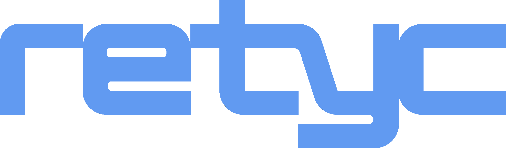

<p align="center"></p>

<p align="center">
  <a href="https://github.com/retyc/retyc-cli/actions/workflows/main.yml"></a>
  <a href="https://goreportcard.com/report/github.com/retyc/retyc-cli"></a>
  <a href="https://github.com/retyc/retyc-cli/releases/latest"></a>
  <a href="LICENSE"></a>
</p>

# Retyc CLI

> Official command-line interface for [Retyc](https://retyc.com) - send transfers and manage datarooms directly from
> your terminal. With **[RetycFS](doc/retycfs.md)**, mount your datarooms as a local folder on Linux. Also runs as a
> local **[MCP server](doc/mcp.md)**: connect your AI agent and control Retyc in plain language.


---

## What is Retyc?

[Retyc](https://retyc.com) is a European sovereign file storage platform with end-to-end post-quantum encryption. Data
stays in Europe, GDPR-compliant by design.

`retyc-cli` lets you integrate Retyc transfers and datarooms into your scripts, pipelines, and workflows - no browser
required.

---

## Installation

### Pre-compiled binaries

Download the binary for your platform from the [latest release](https://github.com/retyc/retyc-cli/releases/latest).

Releases are signed with [cosign](https://docs.sigstore.dev/) (keyless). To verify a binary, download it with
`retyc_sha256_checksums.txt` and `retyc_sha256_checksums.txt.sigstore.json`, then:

```sh
cosign verify-blob \
  --certificate-identity 'https://github.com/retyc/retyc-cli/.github/workflows/release.yml@refs/tags/vX.Y.Z' \
  --certificate-oidc-issuer 'https://token.actions.githubusercontent.com' \
  --bundle retyc_sha256_checksums.txt.sigstore.json retyc_sha256_checksums.txt
sha256sum --check --ignore-missing retyc_sha256_checksums.txt
```

### Linux packages (deb/rpm)

```sh
# Debian / Ubuntu
curl -fsSLO https://github.com/retyc/retyc-cli/releases/download/vX.Y.Z/retyc_X.Y.Z_amd64.deb
sudo apt install ./retyc_X.Y.Z_amd64.deb

# Fedora / RHEL / Rocky
sudo dnf install https://github.com/retyc/retyc-cli/releases/download/vX.Y.Z/retyc-X.Y.Z-1.x86_64.rpm

# openSUSE
sudo zypper install https://github.com/retyc/retyc-cli/releases/download/vX.Y.Z/retyc-X.Y.Z-1.x86_64.rpm
```

### With `go install`

```sh
go install -tags prod github.com/retyc/retyc-cli@latest
```

### From source

```sh
git clone https://github.com/retyc/retyc-cli.git
cd retyc-cli
go build -tags prod -ldflags "-X github.com/retyc/retyc-cli/cmd.Version=$(git describe --tags --always)" -o retyc .
```

### With Docker

```sh
# GitHub Container Registry
docker pull ghcr.io/retyc/retyc-cli:latest
# Docker Hub
docker pull retyc/retyc-cli:latest
```

---

## Quick start

```sh
# 1. Authenticate (opens a browser tab, no password stored)
retyc auth login

# 2. Send a file
retyc transfer create report.pdf

# 3. List your transfers
retyc transfer ls

# 4. Download a transfer
retyc transfer download <transfer-id>
```

---

## Security

- **Authentication**: OIDC device flow (no password ever stored locally)
- **File data + metadata**: end-to-end encrypted with [AGE](https://github.com/FiloSottile/age) post-quantum hybrid keys
- **Private key caching** (Linux only): the decrypted AGE identity is stored in the kernel session keyring and is never
  written to disk.
- **Transport**: TLS enforced by default

---

## MCP Server

`retyc-cli` runs as a [Model Context Protocol](https://modelcontextprotocol.io) server — connect it to your AI agent and
control Retyc in plain language:

> *"Create a dataroom called 'Release v2', upload ./dist/, and add alice@example.com as editor."*
> *"Send all PDFs in ./reports/ to bob@example.com, expire in 7 days."*
> *"List my latest transfers and download the most recent one into ~/Downloads/."*

Full integration guide (Claude Desktop, Cursor, Windsurf, example prompts): [doc/mcp.md](doc/mcp.md)

---

## RetycFS, the Retyc file system

RetycFS mounts your datarooms as a local folder on Linux. Any program can open, edit
and save the files in it: `ls`, `cp`, a file manager, an editor, a script.

```sh
mkdir -p ~/retyc
retyc fs mount retyc://<dataroom-id> ~/retyc   # one dataroom, the root of ~/retyc
retyc fs mount --all ~/retyc                   # or every dataroom, one folder each
```

Full guide: [doc/retycfs.md](doc/retycfs.md)

---

## Documentation

| Topic                                        | Link                                         |
|----------------------------------------------|----------------------------------------------|
| Full commands reference                      | [doc/commands.md](doc/commands.md)           |
| RetycFS (mount datarooms as a folder, Linux) | [doc/retycfs.md](doc/retycfs.md)             |
| MCP server + tools reference                 | [doc/mcp.md](doc/mcp.md)                     |
| Docker usage                                 | [doc/docker.md](doc/docker.md)               |
| Claude Desktop bundle (MCPB)                 | [doc/mcpb.md](doc/mcpb.md)                   |
| CI / CD integration                          | [doc/ci-cd.md](doc/ci-cd.md)                 |
| Configuration & env vars                     | [doc/configuration.md](doc/configuration.md) |

---

## Development

```sh
# Run in dev mode
go run . --help

# Run tests
go test -race ./...

# Production build
go build -tags prod -ldflags "-X github.com/retyc/retyc-cli/cmd.Version=v0.1.0" -o retyc .
```

---

## License

[MIT](LICENSE) - © Retyc / TripleStack SAS
